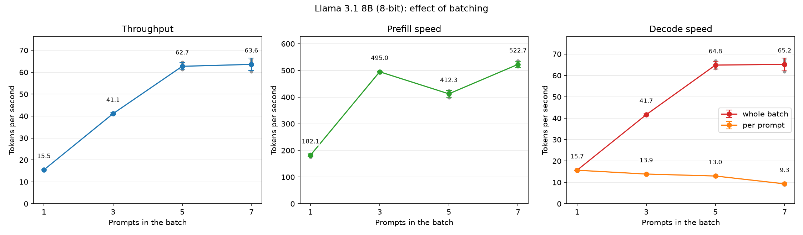

<!-- Last edited: 2026-10-18 10:00 -->
# Experiment: batching, throughput, prefill speed and decode speed

**TLDR:** We asked the 8-bit Llama 3.1 8B to answer 1, 3, 5 or 7 prompts at the same time.
The total number of tokens written per second went up 4 times (15 to 64 tokens/s), because the model reads its weights once per step for all prompts together.
Each prompt got slower as the batch grew (16 down to 9 tokens/s), and the total stopped growing after 5 prompts.

## Question

How does the number of prompts processed together (the batch size) change three speeds?

- **Throughput:** all generated tokens divided by the whole time, prefill and decode together.
- **Prefill speed:** how fast the model reads the prompts.
- **Decode speed:** how fast the model writes the answers.

In a batch, all prompts are read in one pass, and each decode step writes one token for every prompt.
So no prompt has its own prefill time or decode time.
We measure the batch as one job and also show decode speed per prompt.
Our guess before the run: total speed rises with batch size, and each prompt gets slower.

## Method

- **Model:** the 8-bit file `llama-3.1-8b-q8_0.gguf`, from `MODELS[8]` in `scripts/run.py`.
- **Batch sizes:** 1, 3, 5 and 7 prompts, run in that order.
- **Prompt:** the default birthday prompt from `scripts/run.py` (28 tokens), copied N times.
  Every prompt in a batch is the same.
- **Settings:** greedy decoding (`temp=0`).
  Every prompt writes exactly 100 tokens, and end-of-text is ignored, so the batch never gets smaller.
  Context size is 2048, shared by all prompts.
- **Trials:** load the model once.
  At each batch size, run 1 warm-up trial (dropped) and then 3 measured trials.
  The result is the mean of those 3, with the sample standard deviation.
- **How batching runs:** `batched_generate.py` in this folder uses llama.cpp's low-level API.
  Each prompt gets its own sequence id.
  The prompts go through one `llama_decode` call (prefill), then every step feeds one token per prompt into one call (decode).
  `scripts/run.py` is unchanged, because `Llama.generate` handles only one prompt.
  Check: with 1 prompt, this code gave 15.5 to 15.8 decode tokens/s, and `generate_timed` gave 15.4 in a test run.
- **Measures:**
  - `prefill_tps` = N × prompt tokens ÷ time of the prefill call (this includes picking token 1 of each prompt).
  - `decode_tps_total` = N × 99 ÷ time of the 99 decode steps (tokens 2 to 100).
  - `decode_tps_per_stream` = `decode_tps_total` ÷ N.
  - `throughput_tps` = N × 100 ÷ (prefill time + decode time). It counts generated tokens only, not prompt tokens.
- **Machine:** Apple silicon Mac with 24 GB of memory, llama.cpp with all layers on the GPU.

## How to run it again

Run this from the repo root.
It takes about 3 minutes, uses a lot of memory, and overwrites the result files.

```bash
uv run python results/Experiments/batching_throughput/run_experiment.py
```

To redraw the plot from the saved CSVs without running a model, add `--plot-only`.

## Results

Mean of 3 measured trials. Std is the sample standard deviation.

| Prompts | Throughput (tokens/s) | Std | Prefill (tokens/s) | Std | Decode, whole batch (tokens/s) | Std | Decode, per prompt (tokens/s) | Std |
| --- | --- | --- | --- | --- | --- | --- | --- | --- |
| 1 | 15.46 | 0.07 | 182.1 | 5.4 | 15.68 | 0.08 | 15.68 | 0.08 |
| 3 | 41.10 | 0.32 | 495.0 | 0.8 | 41.66 | 0.33 | 13.89 | 0.11 |
| 5 | 62.70 | 1.64 | 412.3 | 12.4 | 64.84 | 1.79 | 12.97 | 0.35 |
| 7 | 63.58 | 2.87 | 522.7 | 11.3 | 65.17 | 3.02 | 9.31 | 0.43 |

Time of one decode step (decode time ÷ 99, mean of 3 trials): 63.8 ms with 1 prompt, 72.0 ms with 3, 77.2 ms with 5, 107.6 ms with 7.



## What we see

- **Throughput rose 4.1 times** from 1 to 7 prompts (15.5 to 63.6 tokens/s).
  Most of the gain came by 5 prompts (62.7).
  From 5 to 7 prompts the change (62.7 to 63.6) is smaller than the spread between trials (std 1.6 to 2.9), so we see no real gain there.
- **Decode speed of the whole batch** follows the same shape (15.7, 41.7, 64.8, 65.2).
- **Decode speed per prompt** fell from 15.7 to 9.3 tokens/s.
  The drop is small up to 5 prompts (to 13.0) and large at 7 prompts.
  A decode step with 7 prompts took 1.7 times as long as with 1 prompt, and it wrote 7 times as many tokens.
- **Prefill speed** rose from 182 to about 500 tokens/s but not in a straight line: 495 at 3 prompts, 412 at 5, 523 at 7.
  The 1-prompt prefill took 0.15 s for 28 tokens, and the 7-prompt prefill took 0.38 s for 196 tokens.
  Our reading: a short prefill has a fixed cost that does not shrink with fewer tokens, so the 1-prompt speed is low.
  We did not measure why 5 prompts is below 3 and 7.
- **Throughput is a little below decode speed** at every batch size, because it includes the prefill wait.

Our reading, not measured: one decode step is mostly the time to read the 8.5 GB of weights from memory.
More prompts share that read, so total speed rises.
At 7 prompts the extra work per step starts to show, so the total stops rising.

## Limits

- One prompt of 28 tokens, copied N times. Real prompts differ in length and content, and the batch would shrink as prompts finish.
- Short prompts. Prefill of long prompts in a batch may behave differently, because it has more tokens to compute.
- One machine, one run of the whole experiment, 3 measured trials per level.
- Only batch sizes 1, 3, 5 and 7. We do not know where the total speed peaks or what happens above 7.
- Greedy decoding with end-of-text ignored, so every prompt wrote exactly 100 tokens.
  After an end-of-text token the model may write unusual text. We did not check the text.
- Throughput counts generated tokens only. If prompt tokens counted too, the numbers would be a little higher.
- We did not measure memory use or the reason for the shape of the curves.
