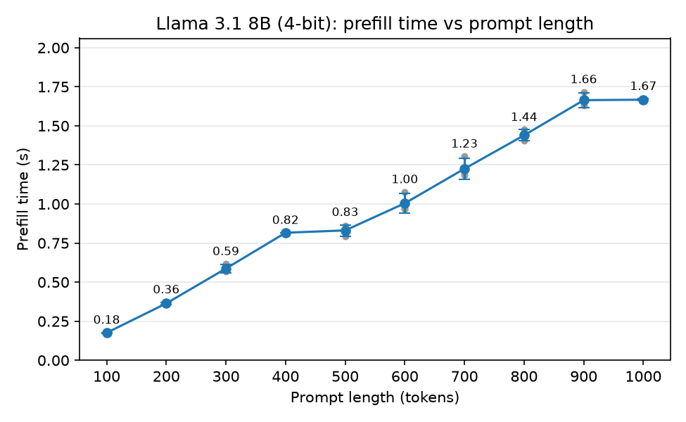
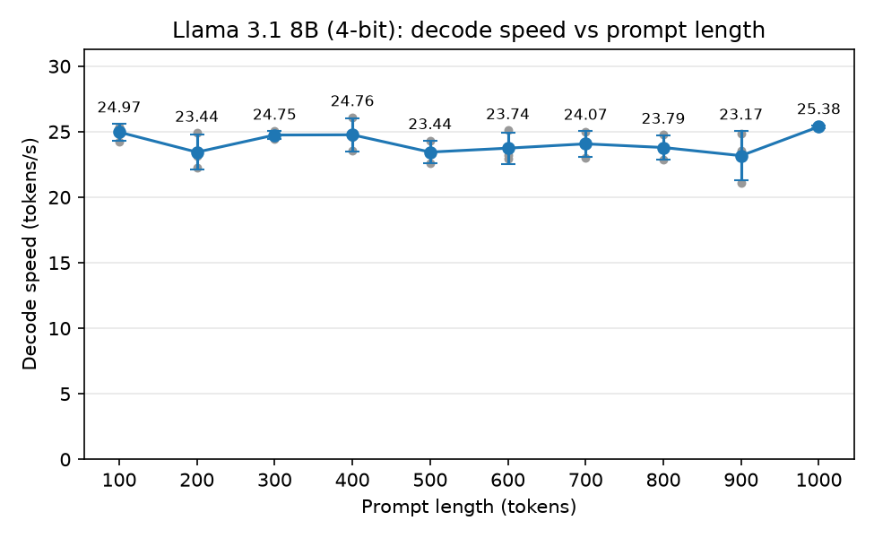

<!-- Last edited: 2026-10-17 11:50 -->
# Experiment: prompt length, prefill time and decode speed

**TLDR:** We gave the 4-bit Llama 3.1 8B prompts from 100 to 1000 tokens long.
Reading a longer prompt takes almost proportionally longer: 10x more tokens took 9.5x more time (0.18 s to 1.67 s).
Writing the answer stayed about the same speed, near 24 tokens per second, whatever the prompt length.

## Question

How does prompt length change the two phases of a reply?
Prefill is the time the model spends reading the prompt before it writes anything (`prefill_s`).
Decode is the writing phase. Decode speed is how many tokens per second it writes (`decode_tps`).
Our guess before the run: prefill gets longer with the prompt, decode speed does not change.

## Method

- **Model:** the 4-bit file `llama-3.1-8b-q4_k_m.gguf` (4.9 GB), from `MODELS[4]` in `scripts/run.py`.
  We chose 4-bit instead of 8-bit only to make the run faster.
- **Prompt lengths:** 100, 200, 300, ... 1000 tokens, run in that order.
  `make_prompt()` in `scripts/run.py` repeats the default birthday prompt and cuts it to the exact length.
- **Settings:** greedy decoding (`temp=0`), at most 100 new tokens, context size 2048 for every length.
  Every trial wrote the full 100 tokens.
- **Trials:** load the model once.
  Run 2 warm-up trials on a 1000-token prompt and throw them away.
  Then run 3 trials at each length. The result is the mean of those 3.
- **Timing:** `generate_timed()` in `scripts/run.py`.
  `prefill_s` is the time to the first token.
  `decode_tps` counts only tokens 2 to 100.
  `prefill_tps` is `prompt_tokens / prefill_s`. We save it but do not plot it.
- **Machine:** Apple silicon Mac with 24 GB of memory, llama.cpp with all layers on the GPU.

## How to run it again

Run this from the repo root.
It takes a few minutes and overwrites the result files.

```bash
uv run python results/Experiments/prompt_length_prefill_decode/run_experiment.py
```

To redraw the plots from the saved CSVs without running a model, add `--plot-only`.

## Results

| Prompt tokens | Prefill s (mean) | Std | Prefill tokens/s | Decode tokens/s (mean) | Std |
| --- | --- | --- | --- | --- | --- |
| 100 | 0.176 | 0.002 | 569 | 24.97 | 0.66 |
| 200 | 0.364 | 0.008 | 550 | 23.44 | 1.35 |
| 300 | 0.587 | 0.026 | 512 | 24.75 | 0.30 |
| 400 | 0.816 | 0.001 | 490 | 24.76 | 1.27 |
| 500 | 0.831 | 0.036 | 602 | 23.44 | 0.87 |
| 600 | 1.004 | 0.063 | 599 | 23.74 | 1.19 |
| 700 | 1.225 | 0.069 | 572 | 24.07 | 0.99 |
| 800 | 1.440 | 0.036 | 556 | 23.79 | 0.95 |
| 900 | 1.664 | 0.046 | 541 | 23.17 | 1.91 |
| 1000 | 1.667 | 0.006 | 600 | 25.38 | 0.11 |

Std is the sample standard deviation of 3 trials.





Files:
- `trials.csv`: every trial, with the `phase` (`warmup` or `measured`), `generated_tokens`, `prefill_s`, `prefill_tps`, `decode_s` and `decode_tps`.
- `summary.csv`: the mean and standard deviation of each of those numbers at each length.
- `prefill_s_vs_prompt_tokens.png` and `decode_tps_vs_prompt_tokens.png`: the plots.
  Blue is the mean with the standard deviation as error bars. Grey dots are the 3 measured trials.

## What we see

- Prefill time grows with prompt length, as we guessed.
  From 100 to 1000 tokens the prompt is 10x longer and prefill is 9.5x longer (0.176 s to 1.667 s).
  So the growth is close to a straight line: about 1.7 ms per extra prompt token.
- The line is not smooth.
  Going from 400 to 500 tokens added almost nothing (0.816 s to 0.831 s), and so did 900 to 1000.
  Prefill speed in tokens per second moves between 490 and 602 with no clear trend.
- Decode speed did not change with prompt length, as we guessed.
  The 10 means sit between 23.2 and 25.4 tokens/s, with no rise or fall as the prompt grows.
  The spread inside a length (std up to 1.9) is as big as the gaps between lengths.

## Limits

- One prompt text (the birthday prompt repeated), one machine, and one run of the whole experiment.
- Only 3 trials per length, so the means are rough.
  The 900-token decode trials range from 21.1 to 24.9 tokens/s.
- The steps in prefill (400 to 500, 900 to 1000) are not explained.
  Our reading is that llama.cpp reads long prompts in fixed-size chunks, which would make some lengths cheaper than a straight line predicts.
  We did not measure this.
- The warm-up used the 1000-token prompt, and the 1000-token results come last.
  Those two facts may help the 1000-token numbers, which are the steadiest in the table.
- Prompts above 1000 tokens are not tested, so we cannot say if prefill stays this straight at long lengths.
- Decode speed here (about 24 tokens/s) is lower than the 26.9 tokens/s that `quantization_decode_tps` measured for the same model with a 28-token prompt.
  That was a different run on a different day, so we do not know if prompt length or machine state caused the gap.
