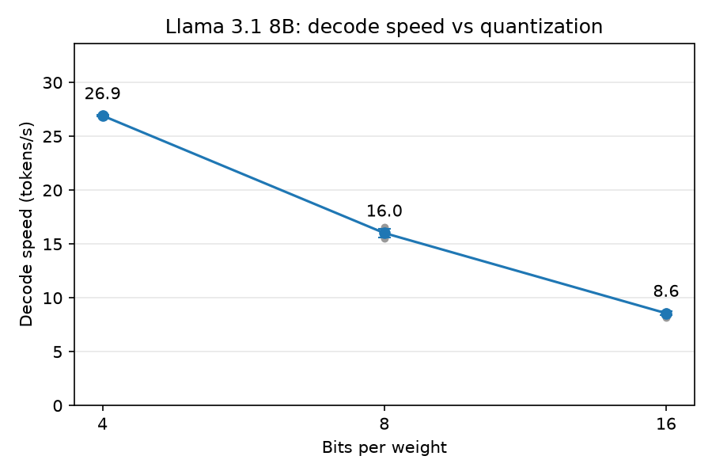

<!-- Last edited: 2026-10-16 08:05 -->
# Experiment: quantization and decode speed

**TLDR:** We ran the same prompt on the 16-bit, 8-bit and 4-bit versions of Llama 3.1 8B.
The smaller the model file, the faster it writes: 4-bit wrote 26.9 tokens per second, 8-bit 16.0, and 16-bit 8.6.

## Question

How much does quantization change decode speed?
Quantization means storing each weight with fewer bits, so the model file gets smaller.
Decode speed is how many tokens per second the model writes after it has read the prompt (`decode_tps`).

## Method

- **Models:** the three files in `models/`, picked with the `MODELS` dict in `scripts/run.py`.
  - 16-bit: `llama-3.1-8b-f16.gguf` (16.1 GB).
  - 8-bit: `llama-3.1-8b-q8_0.gguf` (8.5 GB).
  - 4-bit: `llama-3.1-8b-q4_k_m.gguf` (4.9 GB). This file mixes 4-bit and 6-bit blocks, so it is not pure 4-bit.
- **Prompt:** the `PROMPT` in `scripts/run.py` (the birthday text for mom's 54th birthday), 28 tokens.
- **Settings:** greedy decoding (`temp=0`), at most 100 new tokens, context size 2048.
  Every trial wrote the full 100 tokens.
- **Trials:** for each model, load it once and run 7 trials in a row.
  The first 2 are warm-up and are thrown away.
  The mean `decode_tps` of the other 5 is the result.
- **Order:** 16-bit, then 8-bit, then 4-bit.
- **Timing:** `generate_timed()` in `scripts/run.py` times each token.
  The first token includes reading the prompt (prefill).
  `decode_tps` counts only tokens 2 to 100.
- **Machine:** Apple silicon Mac with 24 GB of memory, llama.cpp with all layers on the GPU.

## How to run it again

Run this from the repo root.
It takes a few minutes and overwrites the three result files.

```bash
uv run python results/Experiments/quantization_decode_tps/run_experiment.py
```

To redraw the plot from the saved CSVs without running a model, add `--plot-only`.

## Results

| Bits | Mean decode tokens/s | Std (5 trials) | Speed-up over 16-bit |
| --- | --- | --- | --- |
| 16 | 8.57 | 0.20 | 1.0x |
| 8 | 16.02 | 0.41 | 1.9x |
| 4 | 26.92 | 0.07 | 3.1x |



Files:
- `trials.csv`: every trial, with the `phase` (`warmup` or `measured`), the times, and `decode_tps`.
- `summary.csv`: the mean and standard deviation for each model.
- `decode_tps_vs_bits.png`: the plot. Blue is the mean with the standard deviation as error bars. Grey dots are the 5 measured trials.

## What we see

- Halving the file size almost doubles the speed.
  16-bit to 8-bit is 1.9x faster. 8-bit to 4-bit is 1.7x faster, and that file is 1.7x smaller.
- Speed times file size is about the same for all three models (roughly 133 to 138 GB/s).
  That fits this idea: for each new token the GPU reads all the weights from memory once, so memory speed is the limit, not math.
  This is our reading of the numbers. The experiment did not measure memory use directly.

## Limits

- Only one prompt, one machine, and one run of the whole experiment.
  The 8-bit trials vary the most (15.5 to 16.5 tokens/s).
- Short prompt. Prefill speed and long-context decode speed are not measured here.
- Speed is only half of the story.
  This experiment says nothing about answer quality, which usually drops as the model gets smaller.
