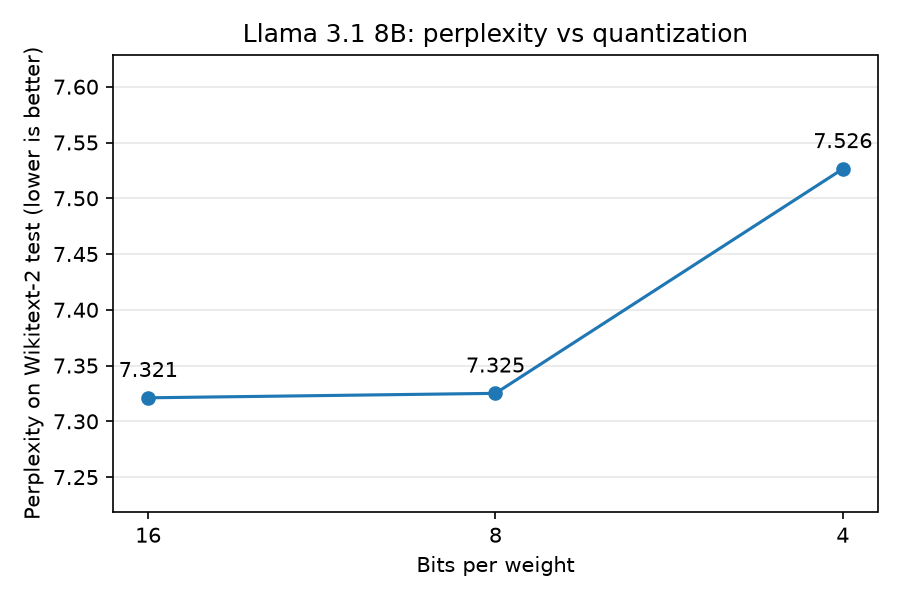

<!-- Last edited: 2026-10-16 08:50 -->
# Experiment: quantization and perplexity

**TLDR:** We gave the 16-bit, 8-bit and 4-bit versions of Llama 3.1 8B the same Wikipedia text and checked how well each one predicts the next word.
16-bit and 8-bit are almost the same (perplexity 7.32 and 7.33).
4-bit is a little worse (7.53, which is 2.8% higher), so shrinking the model costs some quality, but not much until 4 bits.

## Question

How much does quantization change how well the model predicts text?
Quantization means storing each weight with fewer bits, so the model file gets smaller.
Perplexity measures how surprised the model is by real text.
A perplexity of 7.5 means the model is, on average, as unsure as if it were choosing evenly among 7.5 equally likely tokens.
Lower is better.

## Method

- **Models:** the three files in `models/`, picked with the `MODELS` dict in `scripts/run.py`.
  - 16-bit: `llama-3.1-8b-f16.gguf` (16.1 GB).
  - 8-bit: `llama-3.1-8b-q8_0.gguf` (8.5 GB).
  - 4-bit: `llama-3.1-8b-q4_k_m.gguf` (4.9 GB). This file mixes 4-bit and 6-bit blocks, so it is not pure 4-bit.
  - These are the Instruct version of Llama 3.1 8B.
- **Text:** the test split of Wikitext-2 (`wikitext-2-raw-v1`, file `wiki.test.raw`, 1.29 MB).
  The script downloads it to `data/` on the first run. `data/` is not in git.
- **Scoring rule:** the same as llama.cpp's `llama-perplexity` tool. We read its source to check this.
  - The text becomes one token list. We cut it into back-to-back chunks of 512 tokens.
  - The first token of each chunk is replaced by the start token.
  - Each chunk runs on its own, with an empty memory.
  - Only the second half of each chunk is scored. That is 255 predictions per chunk, and each one has at least 256 tokens of context.
  - Perplexity is `exp(mean negative log-probability of the real next token)`.
- **Size of the run:** the whole test text, which gives 564 full chunks and 143,820 scored tokens.
  The leftover tokens at the end, fewer than 512, are dropped. This is the same as llama.cpp does.
- **Trials:** one run per model.
  Perplexity does not depend on sampling, and the text and weights are fixed, so there is no warm-up and no standard deviation.
- **Order:** 16-bit, then 8-bit, then 4-bit.
- **Machine:** Apple silicon Mac with 24 GB of memory, llama.cpp with all layers on the GPU.
- **Code:** `src/llamacppbench/perplexity.py` has the chunking and the maths.
  `tests/test_perplexity.py` tests the log-probability function.

## How to run it again

Run this from the repo root.
It takes about 26 minutes and overwrites the three result files.
It uses most of the Mac's memory, because the 16-bit model is 16 GB.

```bash
uv run python results/Experiments/quantization_perplexity/run_experiment.py
```

To redraw the plot from the saved CSVs without running a model, add `--plot-only`.
To try one model on a few chunks first, add `--bits 4 --max-chunks 2`. This writes no files.

## Results

| Bits | Perplexity | Change vs 16-bit | Run time |
| --- | --- | --- | --- |
| 16 | 7.3211 | 0 | 8.5 min |
| 8 | 7.3251 | +0.05% | 8.2 min |
| 4 | 7.5263 | +2.8% | 9.5 min |



Files:
- `trials.csv`: one row per run, with the chunks, scored tokens, mean negative log-probability, perplexity and wall-clock seconds.
- `summary.csv`: perplexity and the change against the 16-bit model.
- `perplexity_vs_bits.png`: the plot. It has no error bars, because each model was run once.
  The y-axis does not start at zero, so the 4-bit step looks bigger than it is. Read the numbers in the table.

## What we see

- 16-bit and 8-bit are almost the same. The gap is 0.004 perplexity (0.05%).
  Going from 16 to 8 bits halves the file size and costs almost nothing on this text.
- 4-bit is higher by 0.205 perplexity (2.8%).
  The step from 8 to 4 bits is the first one that shows a clear cost.
- The three models read the same text in the same chunks, so the differences come from the weights only.
  Our reading is that a gap this small between 16-bit and 8-bit is below what this test can separate.
  We did not measure the noise, so we do not claim that 8-bit is exactly as good.
- The run times are similar (8 to 10 minutes) and are not a speed benchmark.
  They include the time to turn the scores into probabilities on the CPU, which is the same work for every model.

## Limits

- One text, one chunk size (512), and one run per model on one machine.
  We did not compute an uncertainty for the perplexity, so a 0.05% gap should not be read as a real difference.
- These are Instruct models.
  Their perplexity on Wikipedia text is higher than the numbers usually quoted for base models, so compare only inside this table.
- Perplexity measures how well the model predicts Wikipedia text.
  It says nothing about how well it follows instructions or answers questions.
- The 4-bit file mixes 4-bit and 6-bit blocks, so it is not the same as pure 4-bit.
- Only the second half of each chunk is scored, as in llama.cpp.
  A score from a tool that scores every token, or that uses another context size, will not match ours.
